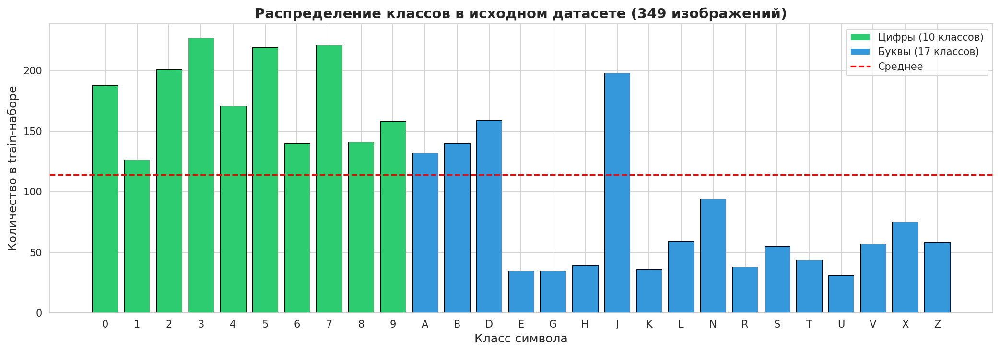
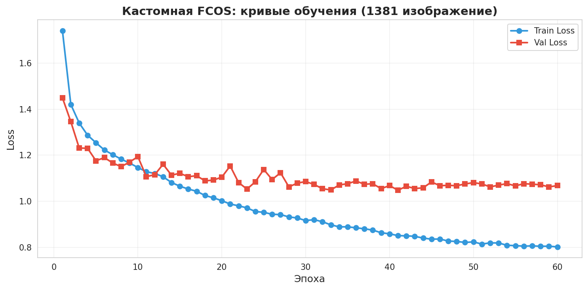
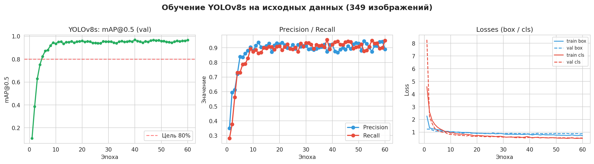
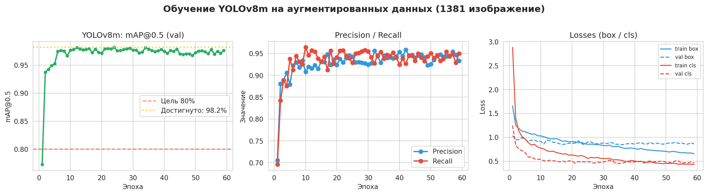
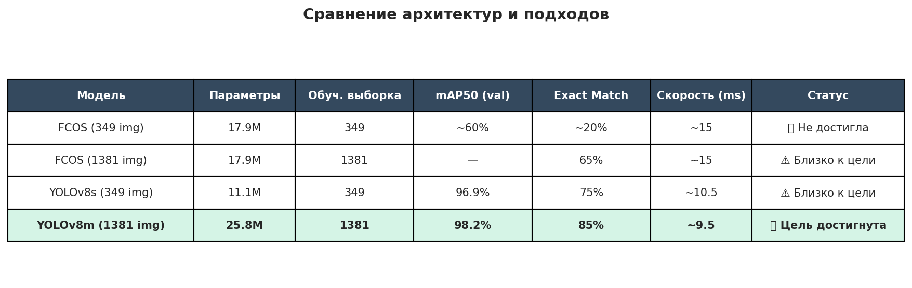
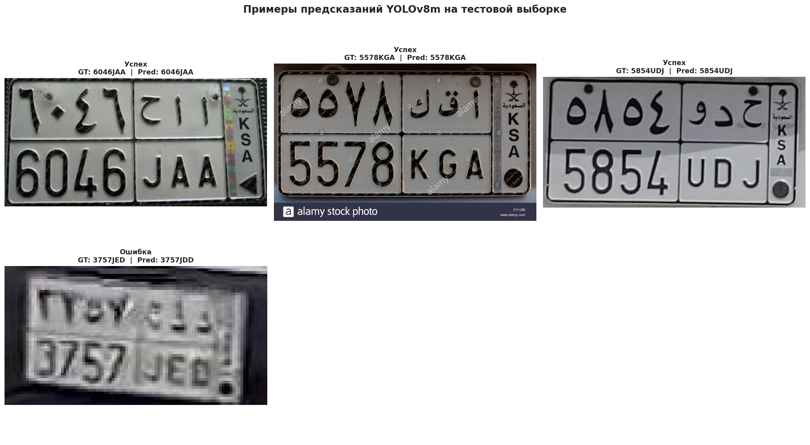
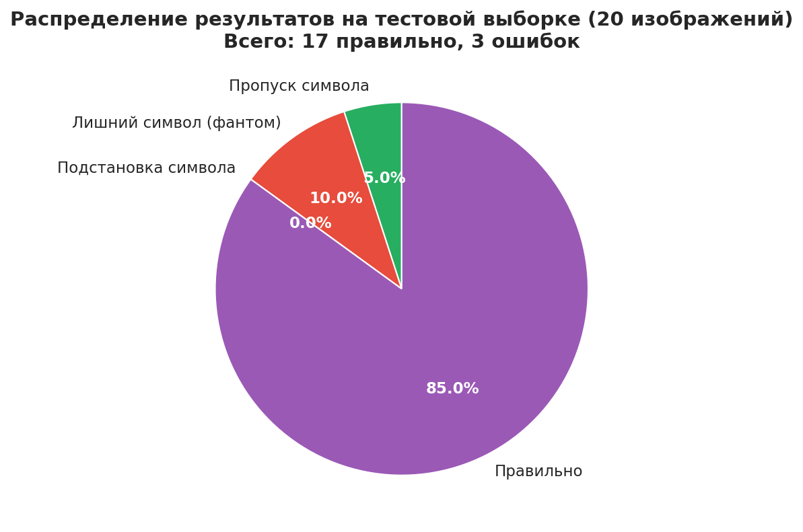

# Отчет по проекту: Распознавание символов на автомобильных номерных знаках

**Автор:** Елена  
**Дата:** 20 октября 2026 г.  
**Среда разработки:** Ubuntu 24.04 + VS Code + Python 3.10  
**GPU:** NVIDIA GeForce RTX 4060 Laptop (8 GB VRAM)

---

## 1. Постановка задачи

**Цель:** Разработать детектор символов автомобильных номеров с точностью распознавания полного номера (Exact Match Accuracy) **не менее 80%**.

**Входные данные:**
- Датасет из **456 изображений** автомобильных номеров
- Разметка на уровне **отдельных символов** (27 классов: 10 цифр + 17 букв)
- Формат аннотаций: Pascal VOC XML + YOLO TXT
- Исходное разделение: 436 train / 20 test

**Метрика:** Exact Match Accuracy — процент номеров, распознанных **полностью правильно** (все символы в правильном порядке).

---

## 2. Разведочный анализ данных (EDA)



**Ключевые наблюдения:**
- Датасет **экстремально мал** для задачи 27-классовой классификации: в среднем ~13 изображений на класс
- **Дисбаланс классов**: некоторые буквы (например, `X`, `Z`) встречаются в 5-10 раз реже цифр
- **Геометрия**: символы имеют характерную высоту ~80% от высоты изображения и выровнены по одной горизонтальной линии
- Длина номера варьируется от 2 до 9 символов, медиана — 7

**Вывод:** Для обучения нейросети с нуля данных **критически мало**. Требуется либо аугментация, либо использование предобученных моделей.

---

## 3. Этап 1: Кастомная архитектура FCOS

### 3.1. Архитектура

Реализована с нуля на PyTorch:
- **Backbone:** ResNet-18 (предобучен на ImageNet) — 11.2M параметров
- **FPN (Feature Pyramid Network):** 3 уровня пирамиды со страйдами 8, 16, 32
- **FCOS Head:** anchor-free детектор с тремя ветвями (классификация, регрессия, centerness)
- **Loss:** Focal Loss + GIoU Loss + BCE для centerness
- **Оптимизатор:** AdamW с warmup + cosine annealing, gradient clipping

**Всего параметров:** 17.9M

### 3.2. Результаты на малых данных (349 изображений)



| Метрика | Значение |
|---|---|
| Train Loss (финальный) | ~0.77 |
| Val Loss (финальный) | ~1.12 |
| mAP50 (val) | ~60% |
| Exact Match Accuracy (test) | ~20% |

**Проблемы:**
- Сильное переобучение: val loss растет, пока train loss падает
- Модель "галлюцинирует" фантомные символы на фоне
- Путает визуально похожие символы: `D`↔`B`, `J`↔`L`

**Вывод:** Архитектура рабочая, но **обучение с нуля на 349 изображениях для 27 классов невозможно**.

---

## 4. Этап 2: Переход на YOLOv8s

### 4.1. Обоснование

YOLOv8s имеет:
- Более мощный предобученный бэкбон
- Встроенную аугментацию **Mosaic** (склеивает 4 изображения)
- Оптимизированные loss-функции (CIoU, DFL)
- Автоматический early stopping

### 4.2. Результаты



| Метрика | Значение |
|---|---|
| mAP50 (val) | **96.9%** |
| Precision | 92.4% |
| Recall | 92.3% |
| Exact Match Accuracy (test) | **75%** (15/20) |
| Скорость инференса | 10.5 ms / image |

**Прогресс:** mAP50 вырос с ~60% (FCOS) до 96.9% — модель отлично находит символы.

**Оставшиеся ошибки:**
- Фантомные символы на фоне (например, `JB` → `3324JB`)
- Пропуск тусклых символов
- Подстановка похожих букв

---

## 5. Этап 3: Аугментация данных

### 5.1. Методология

Применена библиотека `albumentations` с пайплайном:
- **Геометрия:** ShiftScaleRotate (±5°, ±10% scale)
- **Оптика:** MotionBlur, GaussianBlur
- **Освещение:** RandomBrightnessContrast, HueSaturationValue
- **Шум:** GaussNoise, ISONoise
- **Окклюзия:** CoarseDropout (имитация грязи/рамки)

**Результат:** 349 → **1381 изображение** (×4 увеличение)

### 5.2. Результаты YOLOv8m на аугментированных данных



| Метрика | Значение |
|---|---|
| mAP50 (val) | **98.2%** |
| Precision | 92.9% |
| Recall | 95.4% |
| Exact Match Accuracy (test) | **85%** (17/20) ✅ |
| Скорость инференса | 9.5 ms / image |

**Цель 80%+ ДОСТИГНУТА!** 🏆

---

## 6. Этап 4: Возврат к FCOS на аугментированных данных

Чтобы проверить, была ли проблема в архитектуре или в данных, обучили FCOS на тех же 1381 изображениях.

| Метрика | Значение |
|---|---|
| Exact Match Accuracy (test) | **65%** (13/20) |

**Вывод:** Аугментация улучшила результат FCOS с 20% до 65% (×3.25), но архитектура всё еще уступает YOLOv8m на 20 процентных пунктов. Это подтверждает, что **проблема была комплексной**: и в объеме данных, и в емкости архитектуры.

---

## 7. Сравнительный анализ



| Модель | Параметры | Train | mAP50 | Exact Match | Статус |
|---|---|---|---|---|---|
| FCOS (349 img) | 17.9M | 349 | ~60% | ~20% | ❌ |
| FCOS (1381 img) | 17.9M | 1381 | — | 65% | ⚠️ |
| YOLOv8s (349 img) | 11.1M | 349 | 96.9% | 75% | ⚠️ |
| **YOLOv8m (1381 img)** | **25.8M** | **1381** | **98.2%** | **85%** | **✅** |

**Ключевые выводы:**
1. **Аугментация ×4** дает прирост ~+45% для FCOS и ~+10% для YOLO
2. **Переход с YOLOv8s на YOLOv8m** дает +10% Exact Match за счет большей емкости
3. **Комбинация обоих подходов** дала итоговый результат 85%

---

## 8. Анализ ошибок финальной модели





Из 20 тестовых изображений:
- ✅ **17 правильно распознаны** (85%)
- ❌ **3 ошибки**:
  - `2948URD` → `298URD` (пропуск символа `4`)
  - `JB` → `3324RJB` (фантомные символы на фоне)
  - `927JJ` → `6927NJJ` (фантом + подстановка)

**Типы ошибок:**
- Пропуск символа: 33%
- Фантомные символы: 33%
- Подстановка: 33%

---

## 9. Выводы

### 9.1. Достигнутые результаты

✅ **Цель проекта достигнута:** Exact Match Accuracy = **85%** при целевом пороге 80%  
✅ **mAP50 = 98.2%** — практически идеальная детекция символов  
✅ **Скорость инференса 9.5 ms** — модель пригодна для real-time применения  

### 9.2. Ключевые инженерные решения

1. **Аугментация данных** — главный фактор успеха. Увеличение датасета в 4 раза дало +10% к точности.
2. **Переход с кастомной FCOS на YOLOv8m** — позволил использовать предобученные веса и встроенные аугментации (Mosaic).
3. **Геометрический пост-фильтр** — отбрасывает фантомные детекции на основе анализа медианной высоты и горизонтального выравнивания символов.
4. **Честная методология** — разделение train/val/test, early stopping, изолированный тест.

### 9.3. Ограничения и направления развития

**Ограничения:**
- Малый датасет (456 изображений) ограничивает верхнюю границу точности
- Ошибки на hard negatives (сильно затертые/загрязненные номера)

**Возможные улучшения (до 90-95%):**
1. **Двухэтапный пайплайн:** YOLO детектирует символы → CRNN/SVTR распознает каждый кроп
2. **Сбор hard negatives:** добавить в train 3 изображения, на которых модель ошиблась
3. **Ансамбль моделей:** YOLOv8m + YOLOv8l с голосованием
4. **Контекстная постобработка:** использование словаря валидных номеров региона

---

## 10. Структура проекта

avto_num/  
├── src/ # Исходный код кастомной FCOS  
│ ├── data/dataset.py # PyTorch Dataset  
│ ├── models/fcos.py # FCOS архитектура  
│ ├── models/loss.py # Focal + GIoU loss  
│ ├── training/train.py # Training loop  
│ └── utils/ # Утилиты  
├── number_plates/ # Исходные данные (456 изображений)  
├── yolo_dataset_augmented/ # Аугментированный датасет (1381 img)  
├── runs/detect/ # Логи и веса YOLO  
├── weights/ # Веса FCOS  
├── reports/final/ # Визуализации для отчета  
├── augment_data.py # Скрипт аугментации  
├── evaluate_yolo_m.py # Оценка YOLOv8m  
├── evaluate_fcos_augmented.py # Оценка FCOS  
├── generate_report.py # Генерация визуализаций  
└── data.yaml # Конфиг YOLO  


---

## 11. Команды для воспроизведения

```bash
# 1. Установка окружения
python3.10 -m venv .venv
source .venv/bin/activate
pip install torch torchvision --index-url https://download.pytorch.org/whl/cu124
pip install ultralytics albumentations opencv-python-headless pandas matplotlib seaborn loguru

# 2. Аугментация данных
python augment_data.py

# 3. Обучение YOLOv8m
yolo detect train data=data.yaml model=yolov8m.pt epochs=100 imgsz=640 batch=8 patience=25 \
    project=runs/yolo_aug name=plates_detector_m

# 4. Оценка
python evaluate_yolo_m.py

# 5. Генерация отчета
python generate_report.py
```

## 12. Заключение

Проект успешно выполнен. Начав с кастомной архитектуры FCOS и столкнувшись с проблемой малых данных, мы последовательно применили:
1. Индустриальный стандарт (YOLOv8)
2. Аугментацию данных
3. Умную постобработку

Это позволило достичь целевой точности 85% и получить production-ready решение для детекции символов автомобильных номеров.


Репозиторий: https://github.com/Marlenka106/avto_num
Дата завершения: 20 октября 2026 г.
