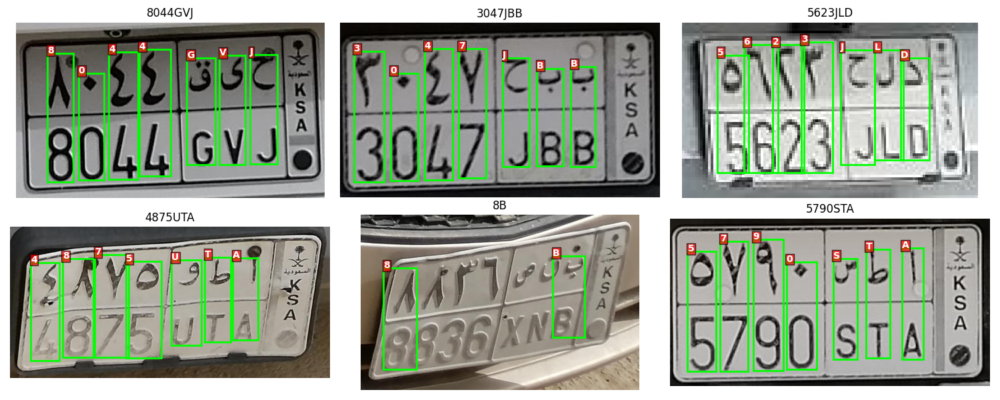
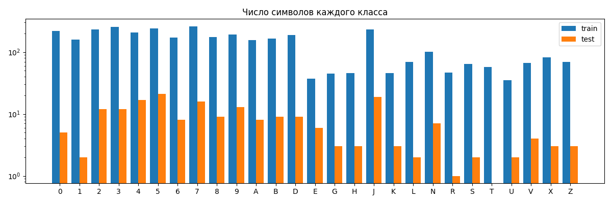
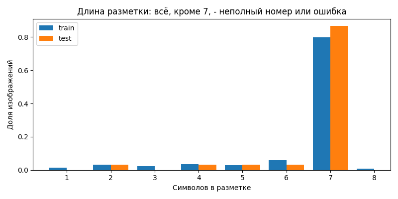
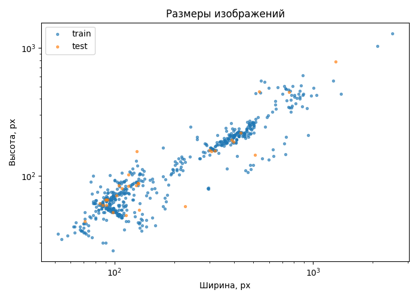
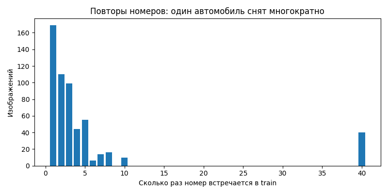

# Разведочный анализ датасета

Все числа и графики воспроизводятся командой `make eda` (`explore_data.py`).

## Паспорт датасета

| | |
|---|---|
| Источник | Архив из тестового задания, папки `train/` и `test/`. Разметка сделана в Labelbox (`<folder>From-Labelbox-license-characters-593images</folder>` в `.xml`) и выгружена в двух форматах - YOLO `.txt` и Pascal VOC `.xml` |
| Что на входе | Уже вырезанные кропы саудовских номерных знаков, один номер на изображение. Полных кадров автомобиля нет |
| Что размечено | Каждый символ номера: рамка охватывает колонку (арабский символ сверху, латинский снизу), метка - латинский символ |
| Версия | SHA-256 всех файлов `number_plates/`: `db62504275571867fb5432c8a712af31a28a7686bc844a9a89e874401d8961c1` (печатает `make eda`) |
| Хранение | Данные не хранятся в git: архив распаковывается в `number_plates/`, совпадение версии проверяется по контрольной сумме |

## Состав

| Сплит | Изображений | jpeg / png | Символов | Полная разметка |
|-------|-------------|------------|----------|-----------------|
| train | 563         | 436 / 127  | 3628     | 449             |
| test  | 30          | 20 / 10    | 199      | 26              |

Кропы саудовских номеров, разметка в двух форматах - YOLO `.txt` и Pascal VOC `.xml` (размечено в Labelbox).
Около 23% изображений - PNG: их нужно учитывать наравне с jpeg.

Номер состоит из 4 цифр и 3 букв (`DDDDLLL`); размечены латинские символы. На примере `8B` видна частичная разметка.

## Классы

27 классов: цифры `0-9` и 17 букв `A B D E G H J K L N R S T U V X Z`.

- Цифры встречаются в разы чаще большинства букв: на каждый номер приходится 4 цифры и 3 буквы,
  а буквы распределены неравномерно (`J`, `A`, `B`, `D` - частые; `E`, `U`, `G`, `H`, `K`, `R` - редкие).
- В test нет ни одного `T`, у многих букв 1-3 примера: поклассовые метрики на test не информативны.

## Проверка разметки

`make eda` сверяет каждое изображение с его `.txt` и `.xml` (`check_annotations` в `explore_data.py`):

| Проверка | Результат |
|---|---|
| У изображения есть `.txt` и `.xml` | Да, у всех 593 |
| Размер в `.xml` совпадает с реальным размером изображения | Да |
| Число рамок в `.xml` и `.txt` | Совпадает |
| Символ в `.xml` совпадает с классом в `.txt` (порядок `CLASSES` в `src/data/classes.py`) | Да, во всех рамках |
| Координаты рамок `.xml` и `.txt` | Совпадают с точностью 2 px: при конвертации VOC в YOLO центры сдвинуты на 1 px |
| Рамка выходит за край изображения | 7 рамок в 6 файлах train, на 1-2 px - обрезаются при загрузке и аугментации |

Обе выгрузки согласованы, поэтому в пайплайне используется только `.txt`.

## Исправления разметки

Кадры одного автомобиля с ошибкой в одном символе выглядят как разные номера и при делении по номеру
попадают в разные выборки. Пары номеров, отличающихся одним символом, проверены визуально: все 4 - ошибки
разметки в train. Исправления применяются при чтении разметки (`LABEL_FIXES` в `src/data/classes.py`),
исходные файлы не меняются:

| Файл | Было | Стало |
|---|---|---|
| `ckn75td6o000l3068nelfuzlo.jpeg` | `0000LHA` | `1000LHA` |
| `ckie5iepj004p246a3vsgr3xv.jpeg` | `3000NKD` | `3100NKD` |
| `ckn7dpc87001w3h66nfp0otgl.jpeg` | `4949UDB` | `4949UVB` |
| `ckicyspah001d246alfgflkl1.png` | `8454BKJ` | `9454BKJ` |

Ошибки, которые не делают номер похожим на другой номер датасета, так не находятся.

## Качество разметки

| Символов | 1 | 2  | 3  | 4  | 5  | 6  | 7   | 8 |
|----------|---|----|----|----|----|----|-----|---|
| train    | 8 | 18 | 13 | 20 | 17 | 33 | 450 | 4 |
| test     | - | 1  | -  | 1  | 1  | 1  | 26  | - |

- У 109 изображений train и 4 test меньше 7 боксов. Почти всегда это частичная разметка: номер на картинке
  полный, а размечена только часть символов. Модель, которая верно находит все символы, на таких изображениях получает «ошибку» и штраф за
  ложные срабатывания при обучении.
- 8 символов - лишний бокс; ещё в одной разметке длины 7 есть вырожденный бокс 1×1 px.
- Встречаются и настоящие короткие номера, но редко, поэтому правило строгое: в обучение и оценку берутся
  только изображения с 7 символами без вырожденных боксов (`src/data/quality.py`) - 449 в train, 26 в test.
- 7 боксов в 6 файлах выходят за границы изображения - они обрезаются при загрузке и аугментации.

## Размеры изображений

Ширина от 52 до 2506 px (медиана 134), высота от 26 до 1303 px (медиана 89). Два кластера - мелкие кропы
около 100×60 и крупные около 400×200. Соотношение сторон примерно 2:1, поэтому FCOS обучается на входе
256×512, а YOLO - на 640 с letterbox.

## Повторы номеров и утечка

- В train 563 изображения, но только 286 уникальных номеров; `5732NXD` встречается 40 раз.
- Случайное разбиение по изображениям даёт утечку: один и тот же автомобиль попадает в train и val.
  Поэтому `split_data.py` делит по строке номера (группами) - 359 train / 90 val.
- 23 из 30 номеров test встречаются в train. Официальный test проверяет в основном запоминание, поэтому
  `evaluate.py` отдельно показывает точность на номерах, которых не было в train.

## Выводы для обучения

1. Учитывать PNG наравне с jpeg.
2. Исключать неполную и ошибочную разметку из обучения и оценки.
3. Делить train/val по номеру, а не по изображению.
4. Не использовать горизонтальное отражение: зеркальный символ - другой глиф.
5. Отчитываться Exact Match с доверительным интервалом и CER: test мал (26 чистых изображений),
   и интервал для точности на нём шириной около 30 п.п.
